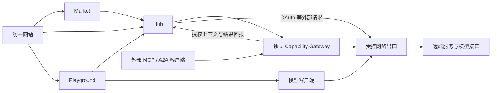

# 架构与关键决策

本文件维护已确认的架构边界与待验证技术方案。系统尚待实现，交付状态见 [开发计划](plan.md)，产品范围与用户规则见 [产品定义](product.md)。

## 系统边界

单仓库采用 `apps/` 与 `packages/`。统一网站包含 Hub、Market 和 Playground，业务后端采用模块化单体，Capability Gateway 独立进程运行，可单独部署与扩容。发布者负责远端服务运行。

| 模块 | 所有权与协作边界 |
|---|---|
| Hub | 服务定义、个人能力引用、协议快照、用户连接、凭证与执行记录。向其他模块提供能力管理、授权、执行和结果查询的公开应用接口 |
| Market | 发布申请、审核、市场条目与分享。安装通过 Hub 建立个人引用 |
| Playground | 模型配置、对话与会话能力选择。通过 Hub 查询和执行能力 |
| 身份与权限 | 用户、团队、角色、平台客户端身份、同意与授权撤销 |
| Gateway | MCP/A2A 会话、协议传输与标识映射。通过受保护的 Hub 接口取得执行上下文并回报真实结果 |

各模块只访问自己拥有的内部表与仓储，跨模块操作通过应用接口完成。Hub 是授权、凭证与执行状态的权威来源，缓存和队列中的副本不能决定权限。

Hub 直接测试与 Playground 调用均通过 Hub → Gateway → 远端服务执行。外部客户端请求 Gateway 后，由 Hub 校验并准备执行，Gateway 完成对应协议传输。直接测试路径独立于平台模型路径，MCP 与 A2A 均须通过测试证明平台模型调用数为零。

API 与 Gateway 使用受服务间认证及 TLS 保护的私网 HTTP 契约。执行上下文绑定用户、客户端、能力版本、操作、参数、执行标识、授权版本与有效期。Hub 统一选取和刷新远端令牌，Gateway 仅在获授权请求的内存中使用，发送前核对当前委托状态。

Market、Playground 可按配置启用，Hub 与共享身份授权作为基础。关闭任一可选模块后，Hub 与获授权 Gateway 路径仍可独立使用。跨进程契约须兼容独立发布，Gateway 多实例时须验证会话路由与任务归属。

## 技术方案状态

以下为待 M1 集成验证的起步方案，具体依赖版本与协议版本在验证后锁定。实现 Agent 可依据验证结果调整候选依赖并记录影响架构的理由。

| 范围 | 起步方案与选择依据 |
|---|---|
| 语言与工程 | TypeScript、Node.js 活跃 LTS、pnpm，便于前后端共享类型 |
| 前端 | React、Vite、React Router |
| 业务后端 | Fastify，按模块化单体组织 |
| 数据 | PostgreSQL、Drizzle，提供事务、关系约束与迁移 |
| 缓存与调度 | Redis、BullMQ，用于共享限流和远端任务查询等调度 |
| 身份与授权 | Better Auth 管理登录会话，协议 SDK 与成熟 OAuth 库处理远端授权。平台 OAuth 授权服务器组件待选，优先集成业务后端 |
| 协议与模型 | MCP/A2A 官方 SDK、OpenAI 官方 JavaScript SDK |
| 测试与部署 | Vitest、Playwright。Linux、Docker Compose、HTTPS 反向代理 |

模型接入已确认采用管理员配置的 OpenAI 兼容工具调用接口，供应商待定。起步采用 Chat Completions 风格契约，须验证实际工具调用和多轮结果回传。目录细分、内部接口形态与调度算法随实现确定。

## 能力版本与执行语义

个人添加的服务与市场发布共用能力目录，私人测试和公开发布的可见范围遵循产品规则。市场安装须幂等建立个人引用，卸载使该引用及其客户端授权范围失效，远端连接由用户单独管理。

编辑版本与已发布版本隔离。入口、认证、工具或技能语义变化须重新验证及相应审核，控制权证据与协议快照关联具体版本。执行绑定服务版本，市场来源还须匹配审核版本。下架、停用或撤权即时阻止对应范围的后续请求，已发送的远端操作保留真实已知状态。授权服务器、客户端配置或资源边界改变后，重新建立对应用户连接。

受保护元数据由发布者使用自己的连接完成验证，仅保存经确认可公开展示的快照。普通用户连接后按自身授权获取实际能力。区分发布者自述、协议读取与平台验证，保留来源和检查时间。健康检查使用公开信息或明确授予的平台检查权限。

执行状态须表达等待确认、执行中、远端进行中、需要输入、成功、失败和结果未知等实际差异，并保留远端状态与任务关联。超时、断线与停止等待不能推断远端失败。刷新页面或进程重启后，可恢复查询已知远端任务。提交结果不确定时先核查，禁止未经核对重复提交副作用操作。

执行确认绑定用户、会话、能力版本与参数，有有效期且只消费一次，参数或版本改变须重新确认。确认政策见产品文档。外部客户端的副作用请求通过平台确认页批准，执行期限届满后未发送的请求失效。

执行记录、确认消费与任务调度应在并发、重试和重启后保持一致，防止重复执行与任务丢失。调度只携带业务标识等必要信息，消费者读取权威状态并重新校验授权。具体持久化与恢复机制由实现选择。

## 协议边界

MCP 与 A2A 共享能力目录，分别使用对应协议客户端。Gateway 分别提供标准 MCP 和 A2A 接口，对外能力同时受个人安装引用、用户授权、显式对外使用许可、客户端权限和当前服务状态约束。发现与每次操作使用同一访问边界。

| 接口 | 本项目要求 |
|---|---|
| MCP | 首版采用远程 Streamable HTTP，支持工具发现、参数校验与调用。用户实际可用工具须同时满足服务验证/市场审核版本及本次启用范围。工具名映射由服务端维护，满足会话唯一性与模型接口约束 |
| A2A | 首版支持文本消息/任务及状态查询，协议版本与 HTTP 绑定在 M1 确定。对外 Card 使用经验证元数据，通信入口指向 Gateway，暴露特性限于远端与 Gateway 已验证支持的交集 |
| A2A 任务归属 | 对外任务与上下文标识关联 Hub 执行及远端标识。消息、查询和产物读取均校验用户、客户端、能力引用及原始远端账号归属 |
| Playground | 模型只获得本次启用且获授权的能力描述。工具请求执行前由 Hub 再校验映射、版本、服务状态、连接、scope、参数、预算与确认，返回真实结果或已知状态 |

A2A 进行中或需要输入时展示真实状态并提供人工交接。首版 AI 流程可停止等待，由用户刷新查询，自动续接模型推理的交付范围见产品文档。模型请求次数、远端操作次数、内容大小和总耗时须有界，到限额时保存真实进度。

协议标准行为交由官方 SDK 与锁定规范实现，版本兼容性以集成验证为准。[MCP 规范](https://modelcontextprotocol.io/specification/)、[A2A 文档](https://a2a-protocol.org/latest/)

## 授权与凭证边界

平台客户端授权与远端服务 OAuth 连接分别校验，令牌按各自资源边界使用。

| 授权层 | 必须满足的边界 |
|---|---|
| 外部客户端 → Gateway | 平台作为 OAuth 授权方，用户明确同意客户端可用的个人能力。令牌绑定平台用户、客户端及对应协议的 Gateway 资源与 scope，每次请求校验 issuer、audience、有效期和即时撤销状态 |
| 平台 → 远端服务 | 使用当前用户的服务连接，按用户、服务、issuer、客户端配置和资源选择令牌，并核对实际获授 scope。服务与授权服务器的关联须验证，A2A Card 声明须与实际认证行为一致 |
| 连接、启用、确认 | OAuth 连接、AI 能力启用、对外使用许可、客户端授权与单次执行确认独立生效，不能相互替代 |

授权交互采用授权码与 PKCE，回调精确匹配并绑定发起用户、会话及一次性事务，防止串号与重放。Gateway 按 MCP 资源发现与 A2A Card 安全方案声明授权方式。客户端登记和兼容性按锁定规范验证。[OAuth 安全最佳实践](https://www.rfc-editor.org/rfc/rfc9700.html)

刷新与断开连接并发时，旧刷新结果不得恢复已撤销连接或覆盖更新后的令牌。缺少刷新令牌、刷新失败或 scope 不足时，引导重新/补充授权。断开立即阻止后续请求与后台轮询，清理本地令牌，并在授权方支持时撤销远端授权。重新连接后查询原任务仍须核对账号及任务归属。

凭证由服务端使用成熟密码库认证加密保存并按授权取用，远端用户令牌、OAuth 客户端凭证与管理员模型凭证分别隔离，主密钥由运行环境提供并与数据库备份分离。凭证仅以安全摘要出现在浏览器、模型输入、日志和错误响应中。远端工具描述、Card 与结果均为不可信数据，权限、凭证选择和确认由服务端控制。远端副作用声明仅作审核输入，只读核验与确认策略由平台决定。

## 网络与数据保护

所有外部访问统一应用出口策略，涵盖模型接口、协议元数据、OAuth 请求、实际调用、重定向与任务查询。公网入口使用 HTTPS，校验目标协议、主机、端口与解析地址，阻断回环、私网、链路本地、保留地址与云元数据入口。校验全部解析地址并约束实际连接，防止 DNS 变化绕过检查，保留正确的 Host 与 TLS 校验。开发本地服务通过隔离的显式测试配置访问。

重定向逐跳校验，跨源移除认证信息。Card、协议结果提供的后续地址和浏览器授权目标同样校验。令牌限定在批准的 issuer、资源、来源与路径范围内，跨来源入口须先验证授权关系。SDK 必须能接入受控传输，部署配合网络出口限制。请求时间与响应大小设置上限。

登录复用成熟身份库，邀请制准入、会话失效、CSRF 防护、登录限流与管理员初始化须一并验收。用户仅可访问自己的连接、会话和调用内容，发布者仅查看获授权的所属服务运行信息，管理员排障访问留痕。

仅保存必要的业务、审核和执行信息，日志采用脱敏摘要。会话删除按权限处理关联内容与保留的执行摘要，远端数据留存责任须向用户告知。内容保留期、备份周期与数值限额的待定事项统一见开发计划。
